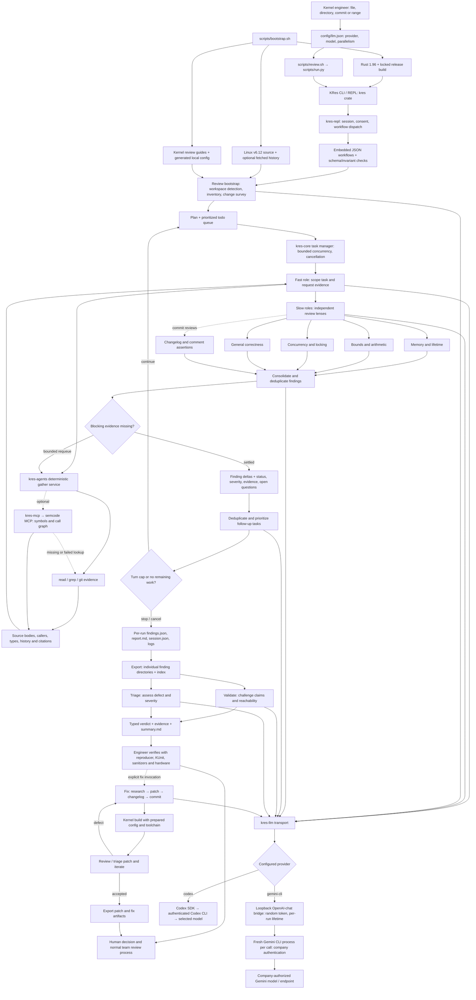

# KRes architecture and complete workflow

This diagram describes the pinned upstream engine and this demo's provider
selection. Dashed optional paths need additional configuration or explicit use.

The model roles are responsibilities, not separate model subscriptions. This demo
selects one model for all roles. A second independent model requires additional
upstream configuration. Classification defaults to the fast provider.

The Gemini bridge translates KRes chat requests to a text conversation on CLI
stdin and converts CLI JSON responses to chat-completion responses. It buffers
each response; it does not stream tokens, implement tool calling, share CLI
sessions or report reliable token costs. KRes continues to gather source itself.
The bridge binds only loopback and requires an ephemeral bearer token.

Retained files include source, toolchain, build outputs and configuration.
Processes are transient. Each Gemini run starts and stops its own bridge.
No bridge or CLI process needs to survive a cloud snapshot. Review output is
evidence for engineering investigation, not proof of correctness.
