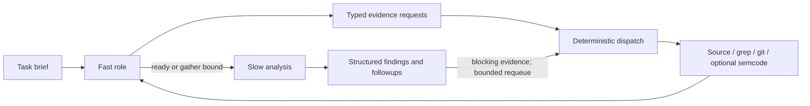

# How KRes works internally

This document explains the KRes snapshot vendored in this repository at upstream
revision `4ef4b706358abfcb82d112213632f4a8edda2868`. It describes implementation
and intended behavior, not a claim that every workflow has been executed here.
For the visual overview, see [architecture.md](architecture.md). For commands,
see [how_to_use.md](../how_to_use.md).

## 1. What KRes is designed to do

KRes means Kernel code RESearch agent. It coordinates model calls, source
retrieval, research tasks and structured findings across large source trees.
Linux is its primary target. Its central job is to keep investigating a source
area across multiple tasks instead of producing one answer from one prompt.

For example, a driver review may start with an error path, discover that a
workqueue retains a pointer, inspect teardown ordering, investigate callers,
then record a suspected lifetime defect. Missing evidence becomes explicit
research work. A subsequent validation pass can challenge that suspicion before
an engineer spends time producing a patch.

The application combines probabilistic model reasoning with deterministic Rust
control flow. Models propose evidence requests and conclusions. Rust dispatches
tools, validates response structures, manages tasks, applies finding changes and
executes workflow transitions. Structural validation cannot guarantee that the
reasoning is correct, but it makes malformed answers and some contradictory
state transitions detectable.

## 2. Implementation layers

| Component | Responsibility | Useful source entry point |
|---|---|---|
| `kres` | CLI arguments, provider selection, REPL or workflow entry, provider tests | [main.rs](../vendor/kres/kres/src/main.rs) |
| `kres-repl` | Session, interactive/TUI behavior, dispatch, completed-task processing, review preparation | [session.rs](../vendor/kres/kres-repl/src/session.rs) |
| `kres-core` | Tasks, plans, todos, findings, persistence, cancellation and cost data | [task.rs](../vendor/kres/kres-core/src/task.rs), [findings.rs](../vendor/kres/kres-core/src/findings.rs) |
| `kres-agents` | Gather/analyze pipelines, followups, prompts, tools and workflow execution | [pipeline.rs](../vendor/kres/kres-agents/src/pipeline.rs), [workflow_exec.rs](../vendor/kres/kres-agents/src/workflow_exec.rs) |
| `kres-llm` | Provider connections, request conversion, responses, retries and transport-specific behavior | [client.rs](../vendor/kres/kres-llm/src/client.rs) |
| `kres-mcp` | Communication with optional MCP servers | [crate source](../vendor/kres/kres-mcp/src) |

The JSON files in [configs/workflows](../vendor/kres/configs/workflows) define
review, validate, triage and fix contracts. System prompts and workflow defaults
are embedded in the binary; supported operator overrides can shadow them.
Changing an embedded default requires rebuilding. Changing a local override
does not modify the original source snapshot.

## 3. Startup: turning a question into a session

For this demo, `scripts/review.sh` calls `scripts/run.py`. The launcher reads
`config/llm.json` or the file passed with `--config`, generates a temporary
provider configuration, and launches KRes from the downloaded Linux checkout.
That launcher is demo-specific; upstream KRes can be launched directly.

KRes resolves role/model configuration, initializes session state and artifact
paths, configures the action allowlist, and detects the workspace type. Linux
detection selects kernel skills and make-oriented assumptions. The review
guides supply domain knowledge; they do not execute kernel tests themselves.

Each review run receives a separate results directory. This prevents concurrent
runs from overwriting findings or resumable state. Paths and session IDs appear
in the console so that an engineer can locate the corresponding artifacts.

## 4. Roles are responsibilities, not necessarily different models

| Role | What it does |
|---|---|
| Fast | Scopes a task and requests additional evidence through typed followups |
| Deterministic tool service | Executes validated requests using local tools or MCP; this is not an LLM role |
| Slow | Performs deeper analysis after evidence gathering; also supplies review-specific planning and completion reasoning |
| Main | Helps establish goals/plans and checks completion in generic sessions |
| Todo | Reconciles followups with existing work in generic sessions |
| Prioritizer | Ranks dispatchable tasks; uses the slow model and falls back to storage order if ranking fails |
| Consolidator/promoter | Merges sibling review outputs and checks concrete observations that appeared only in prose |
| Classifier | Supports prompt/command interpretation where classification is needed |

The roles can share one model. Fast versus slow describes their prompts and
responsibilities; it does not automatically mean two different products or
reasoning models. This demo defaults to one configured model across roles.

An important distinction: the main role is not a model-based intermediary for
every source lookup. The current implementation sends typed requests to the
deterministic gather service. Dedicated review goal/todo clients use the primary
slow model; generic sessions use the configured main/todo roles.

## 5. Preparing a whole-file review

A named-file review has work before the main task loop. KRes can inspect recent
file history, gather a structural inventory and prepare a semantic research plan.

The history path uses rename-aware `gix` operations to construct a net target-file
diff covering relevant changes in a six-month window, including working-tree
edits. The goal is to assess the current net change rather than treating every
historical intermediate version as an independent current defect. Large inputs
can be partitioned, assessed and reconciled. Change-survey state is checkpointed
beside session state for supported resume behavior.

The inventory identifies functions and relationships to guide the plan. Optional
semcode indexing can accelerate structural queries. If that service is absent
or its survey is unusable, KRes uses local source evidence and model-backed
fallback inventory work. A fallback can therefore require inference before any
ordinary review task completes.

Inventory and risk ratings are planning aids, not correctness proofs. They do
not replace source inspection by the review tasks. Details of this preparation
have evolved within upstream; the pinned source and workflow contracts take
precedence over older architectural prose.

Our demo's Linux checkout is shallow. It supplies source for a review, but not
the full preceding history for regression or backport investigations. Fetch
the appropriate history before relying on those capabilities.

## 6. The evidence-gathering loop inside a task

The fast role receives a question and context. It can ask for reads, searches,
symbols, callers, types or Git evidence using structured followups. The gather
service validates and executes supported operations, returns evidence, and lets
the fast role decide whether more is needed. Gathering stops when it signals
readiness or reaches its configured gather bound.

The slow role receives the brief and gathered material. It returns analysis,
structured findings and followups. A blocking evidence request can trigger a
bounded fetch-and-reanalyze requeue inside the task, rather than forcing the
question into an unrelated later task. The pinned constant allows at most three
requeue rounds, subject to eligibility rules; it is not a promise of three
extra calls for every task. See [followup.rs](../vendor/kres/kres-agents/src/followup.rs).

The distinction between a blocking and nonblocking followup matters. Blocking
evidence is needed to settle the current analysis. Other useful investigations
can become separate prioritized tasks.

### Optional semcode

Semcode can answer function/type/caller/callee/callchain queries through MCP.
KRes still works without it using local read, grep and Git operations. A missing
index result is not authoritative proof that a symbol or caller does not exist;
the implementation is designed to fall back to local evidence.

## 7. Independent review lenses

The review workflow asks different reviewers to inspect different bug classes:

| Lens | Typical question |
|---|---|
| Memory and lifetime | Can this object be freed while still referenced? |
| Bounds and arithmetic | Can a length, index or size calculation exceed its valid range? |
| Races | Can concurrency violate the required ordering or locking invariant? |
| General correctness | Are return values, state transitions or semantic assumptions wrong? |
| Assertions, for commit/range review | Do the changelog and comments accurately describe behavior? |

Sibling lenses reason separately before consolidation. This encourages distinct
lines of investigation, but multiple calls to one model are not independent
models and can share blind spots. A clean lens also does not certify complete
coverage of the whole kernel.

An optional secondary slow model adds a supplemental opinion: general review
for reviews and maintainer review during fixes. `--compare` instead expands
every active lens over the selected models. These modes change inference cost
and latency. The demo does not configure a second model by default.

If some lenses fail, successful outputs can still be consolidated while missing
coverage becomes followup work. An all-lenses-failed task is an error. This avoids
treating failed coverage as a clean result or discarding every successful lens.

## 8. Findings, followups and deterministic state

A finding is a persistent structured record, not just a paragraph. It can carry
an ID, title, severity, status, summary, source evidence, symbols and unresolved
questions. Successive tasks submit deltas that update the canonical store.

Rust applies those changes. An update can preserve an existing finding's title
and evidence without requiring the model to resend the entire record. Incomplete
new records can be refused. Invalidating a finding requires a premise and cited
evidence, making the claimed disproof inspectable. If the evidence is unresolved,
an unconfirmed status is different from disproving the bug.

Invalidated findings remain useful negative evidence. Otherwise a later task
could rediscover the same rejected suspicion without seeing why it was rejected.
Prior findings remain available to review reasoning, while repeated embedded
source bodies can be omitted from prompt history with citations retained for
refetching. This separates context efficiency from silently hiding findings.

Followups are deduplicated against existing work and ranked before dispatch.
Task dependencies prevent work from running before its prerequisites settle.
The scheduler bounds concurrent tasks; that bound is not necessarily the number
of simultaneous provider requests because a task can contain lens fan-out.

## 9. Response contracts and workflow execution

Workflow steps declare outputs and acceptance checks. Model steps use a gather
phase and a synthesis phase with different prompts: gathering asks what evidence
is needed; synthesis must satisfy the step's output contract.

The implementation parses structured output, checks Rust DTOs and workflow JSON
schemas, and can request repair when parsing or validation fails. Narrow transport
normalization can extract a single JSON object or handle a whole JSON fence, but
it does not authorize inventing missing semantic conclusions. Original responses
remain available in logs.

Typed values determine retries, branches and completion. Free-form analysis
should not secretly decide whether a finding is invalid or a workflow succeeded.
An eval failure can retry a step or route execution according to its declared
contract. Deterministic reaper actions perform operations such as builds,
commits and finding-artifact updates without asking a model to execute them.

This is a central distinction from asking one chatbot to review code and then
accepting whatever narrative it returns. The model reasons inside a program
whose state transitions are implemented and inspectable.

## 10. The four workflows

### Review: discover and investigate

Review prepares context, creates work, runs lenses and reconciles followups
through the task/todo loop. Its shipped JSON contains one investigate step,
but that does not mean one model call or one total investigation. The review
loop supplies the repeated research behavior.

### Validate: try to disprove a finding

The pinned validation definition has these steps:

1. `validate-claims`: check factual claims and record source provenance.
2. `validate-conjunction`: check whether the claimed preconditions can hold
   together on one execution.
3. `validate-reachability`: reason about reachability and the resulting verdict.
4. `validate-refute`: attack a plausible result using the primary slow model.
5. `validate-refute-secondary`: use a genuinely different secondary model when
   available and permitted by the workflow guards.

Refutation steps are conditional; they are not automatically five successful
calls on every finding. Without a configured second model, there is no independent
secondary-model validation. Schema and builtin checks constrain the outputs,
but a surviving verdict still needs engineering verification.

### Triage: assess an exported finding

Triage researches an individual finding, assesses severity/status and writes
summary artifacts. It is different from the deeper claim/conjunction/reachability
challenge performed by validation.

### Fix: produce and check a candidate patch

The fix workflow can research the bug, invalidate or unconfirm it, record bugs,
search related history/lore, write a patch and changelog, commit, build, triage
compile failures, review, reconcile defects and export patch artifacts. Its
orchestrator and guards determine which paths execute and which repeat.

This workflow mutates the source tree and Git state. Its publish actions refer
to workflow patch artifacts; do not assume they mean automatic public GitHub
submission. A successful configured build is not proof that the kernel boots,
that a race is resolved, or that a device works. Prepare the correct development
branch, architecture/toolchain and product config before using this path.

## 11. Completion, persistence and observability

`--turns N` limits completed tasks, not API calls. A completed task has passed
through its pipeline and produced qualifying output. Bootstrap calls do not
become completed review tasks merely because they started. In-flight parallel
tasks can make the final completion count exceed N. The limit is not a strict
wall-time or spending cap.

Without a numeric cap, stopping depends on goal checks, pending work and the
chosen follow/stagnation behavior. Review-specific guards preserve concrete
followups so that a goal-met conclusion does not silently discard required work.
See the pinned [stopping rules](../vendor/kres/docs/turns-and-follow.md).

| Artifact | Purpose |
|---|---|
| `prompt.md` | Original review question/contract used by the run |
| `findings.json` | Canonical merged findings; atomically persisted |
| `report.md` | Accumulated task narrative when tasks produce it |
| `session.json` | Plan/todo/deferred work and completion state |
| `change-survey.json` | Change-survey checkpoint when that path produces it |
| `.kres/logs/<session>/code.jsonl` | Model exchanges and diagnostic metadata |
| `.kres/logs/<session>/main.jsonl` | Main/associated role logging where used |
| `.kres/logs/<session>/console.jsonl` | Scheduler and console progress narrative |

Not every file is present in a failed startup. Logs can contain source and other
sensitive material, so review them before sharing. Token/cache statistics depend
on provider support. Session resume uses saved state; it cannot repair expired
authentication or recreate missing source dependencies by itself.

Summary generation is explicit. Reaching the turn cap does not automatically
render a summary. Upstream summary commands run finding validation first, then
render validated narratives and exclude specified rejected/fixed verdicts.
They are additional inference work, not a cheap formatting-only operation.

## 12. What makes this approach useful

These are design distinctions from a basic single-prompt review, not benchmarked
claims that KRes beats every other tool.

| Capability | Practical value | Limit |
|---|---|---|
| Evidence-first gather/analyze split | Lets deeper reasoning inspect actual code and callers | Gathering can still miss relevant paths |
| Persistent research queue | Investigates cross-file leads over many tasks | More research increases time and cost |
| Specialized lenses | Encourages coverage across lifetime, bounds and races | Same-model reviewers can repeat mistakes |
| Structured finding lifecycle | Preserves updates, unresolved questions and disproof evidence | Well-formed records can still be factually wrong |
| Validation after discovery | Separates finding a suspicion from trying to break it | Does not replace a reproducer or test |
| Typed workflow checks | Makes branching, retries and acceptance inspectable | Checks only enforce what their contracts express |
| Optional semantic indexing with fallback | Accelerates navigation without requiring an index | Macro-heavy source and complex call paths remain hard |
| Kernel skills and history context | Supplies subsystem rules and change context | Requires relevant guides and sufficient source/history |
| Fix/build/review iteration | Connects research to candidate patches | Correct product builds and device tests remain your responsibility |
| Per-run artifacts and resume | Makes long investigations auditable | Logs need protection; resume needs valid runtime prerequisites |

KRes adds research orchestration around LLMs. It is not a compiler, formal proof
system, race detector, fuzzing engine or hardware simulator. It complements
compiler diagnostics, static analysis, KUnit/kselftest, syzkaller, sanitizers,
lockdep, stress tests and ordinary maintainer review.

## 13. Gemini CLI in this demo

Gemini support is a demo-layer addition, not a native provider in this upstream
snapshot. `scripts/run.py` starts a loopback adapter and gives KRes a temporary
OpenAI-compatible chat configuration. `scripts/gemini_bridge.py` turns each
request into a fresh company Gemini CLI process, passes context on stdin, reads
the JSON response and returns assistant text to KRes. KRes still owns source
retrieval, planning, findings and workflows.

This route buffers responses and does not provide reliable token-cost reporting
or provider-native prompt-cache control. Flattening conversation roles into text
also differs from a native role-aware API. CLI flags, output JSON, authentication
and company policies must match the wrapper actually installed.

The launcher currently wraps provider tests and review. It does not supply a
general Gemini launcher for validation, triage, summaries or automatic fixing.
Upstream having those features does not mean this adapter exposes all of them.
The adapter asks the CLI not to use tools, but that instruction is not a security
boundary; enforce restrictions through company policy and appropriate runtime
isolation.

## 14. Current evidence and a sensible company pilot

The release build, workflow-schema checks and 248 core tests passed during setup.
The Gemini adapter passed tests with a fake CLI and the real KRes binary. Those
tests establish adapter behavior, not successful company inference.

Actual Codex review attempts initialized the workflow but did not complete a
review task: early runs hit network restrictions, and the published-environment
attempt hit an authentication refresh failure. See
[the latest captured run](workflow-run-published-2026-10-28.log). No end-to-end
model-backed kernel review or real company Gemini review is claimed.

For a company pilot, authenticate the approved Gemini CLI, pass the provider
test, complete one public-file review, inspect every reported finding manually,
and only then try approved internal source. Use the exact product source,
configuration and history for product conclusions. Measure useful validated
findings, false positives, elapsed time and actual provider usage; do not measure
success by how many findings the model emits.

## References

- [Current roles and task flow](../vendor/kres/docs/agents.md)
- [Workflow behavior](../vendor/kres/docs/workflow.md)
- [Workflow contracts and validation internals](../vendor/kres/docs/workflow-internals.md)
- [Summary behavior](../vendor/kres/docs/summary.md)
- [Configuration and provider selection](../vendor/kres/docs/configuration.md)
- [Review contract](../vendor/kres/configs/workflows/review.json)
- [Validate contract](../vendor/kres/configs/workflows/validate.json)
- [Fix contract](../vendor/kres/configs/workflows/fix.json)
